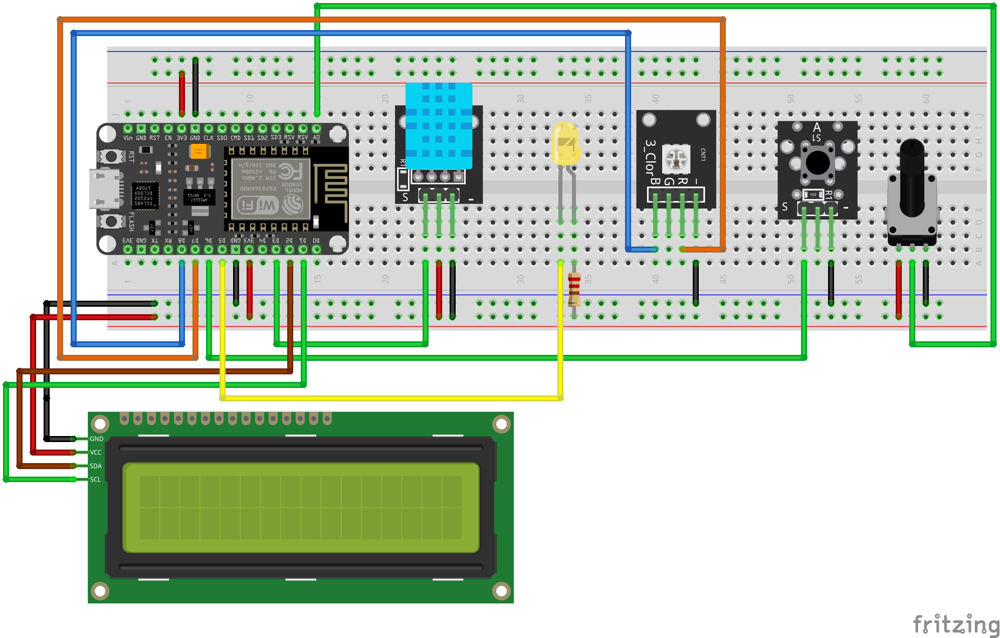

# Room Monitoring System

This project implements an IoT monitoring system designed to collect environmental data across multiple rooms in a building. The system measures temperature, humidity, and Wi-Fi signal strength, and provides immediate visual feedback through LEDs based on configurable threshold values. Collected data is stored in InfluxDB and visualized through dashboards, enabling real-time monitoring and historical analysis.

## Required libraries

- [ArduinoJson](https://github.com/bblanchon/ArduinoJson) 7.4.3
- [DHT sensor library](https://github.com/adafruit/DHT-sensor-library) 1.4.7
- [ESP8266 Influxdb](https://github.com/tobiasschuerg/InfluxDB-Client-for-Arduino) 3.13.2
- [LiquidCrystal I2C](https://github.com/johnrickman/LiquidCrystal_I2C) 1.1.2
- [MQTT](https://github.com/256dpi/arduino-mqtt) 2.5.2 (2.5.3 may cause repeated connection/disconnection)
- [WiFiManager](https://github.com/tzapu/WiFiManager) 2.0.17

## Hardware materials

- NodeMCU ESP8266
- Temperature and humidity sensor (DHT11)
- 2x Button (KY-004)
- 10kΩ resistor
- Linear potentiometer (KY-040)
- Display (LCD1602A)
- Yellow led
- 220Ω resistor
- RGB led (KY-009)

## Sketch

